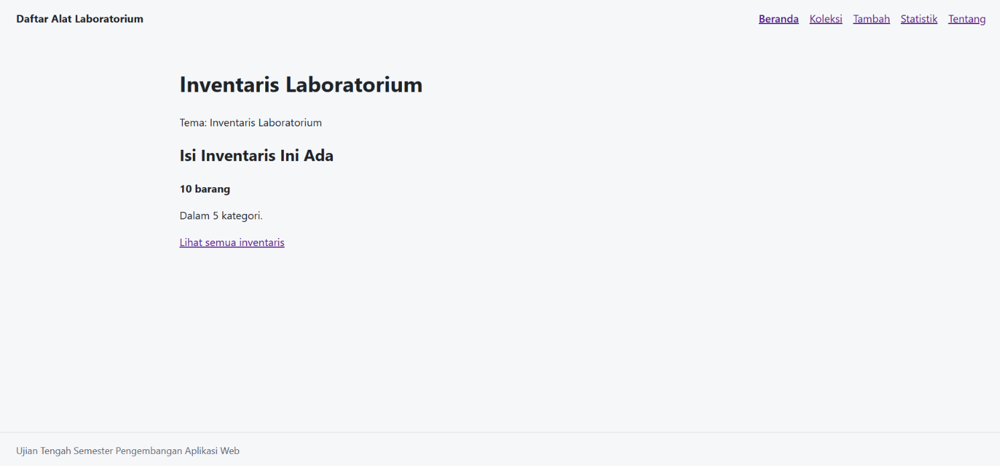
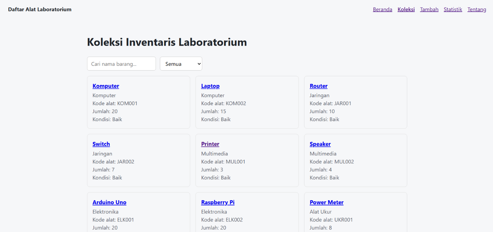
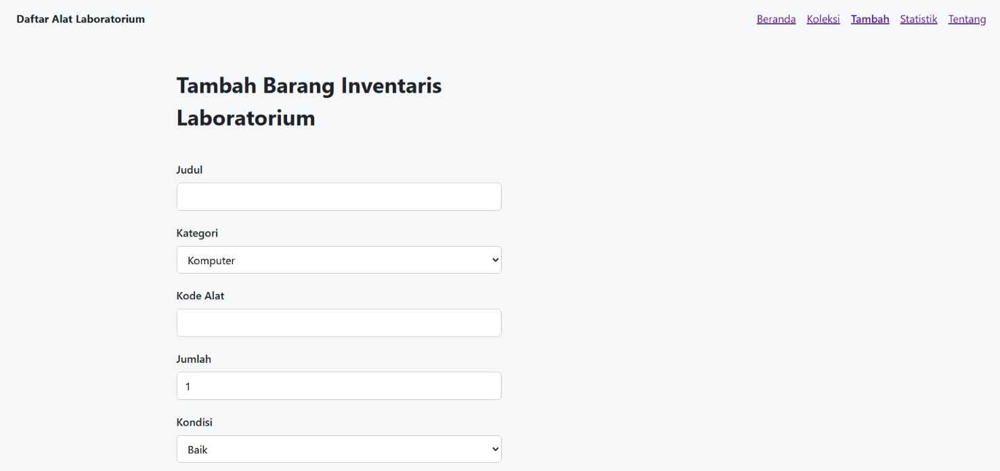
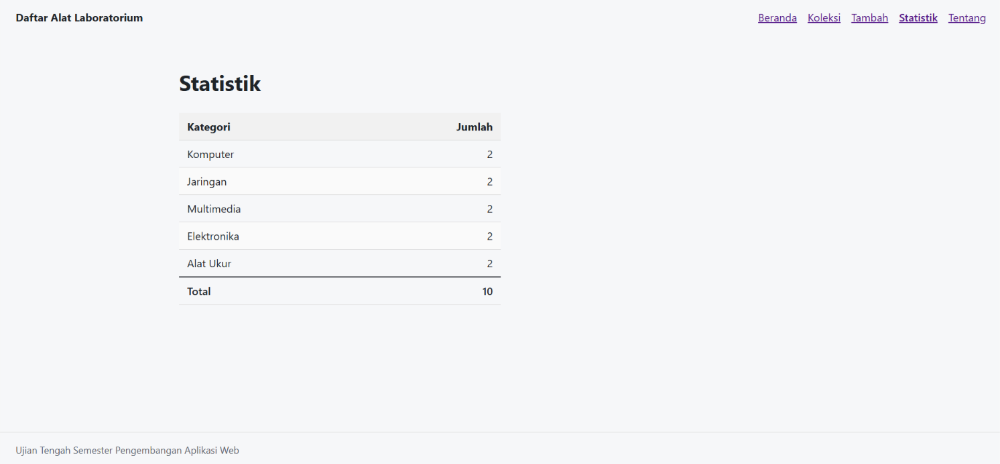
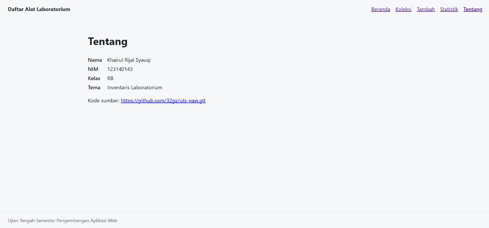
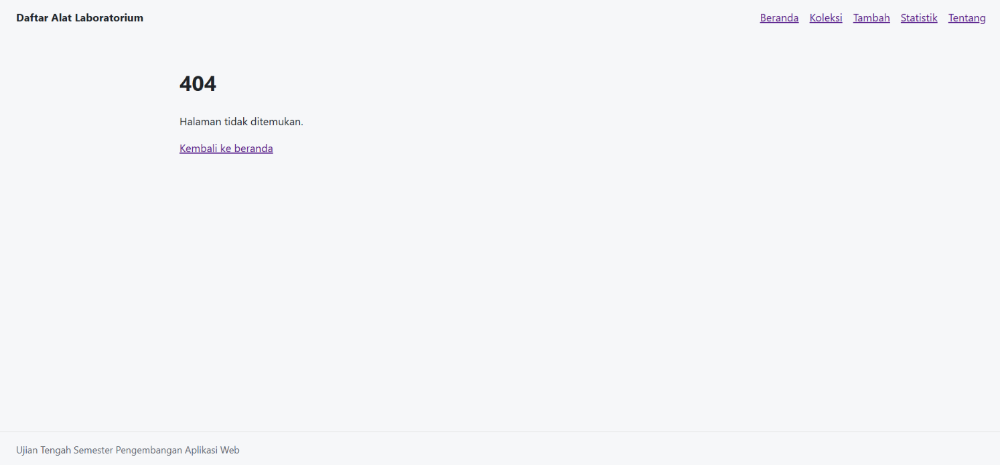

# Inventaris Laboratorium

Nama: Khairul Rijal Syauqi
NIM: 123140143
Kelas: RB
Tema: Inventaris Laboratorium
Deployment: https://32gz.github.io/uts-paw/

## Screenshots

### 1. Beranda

### 2. Koleksi

### 3. Tambah

### 4. Statistik

### 5. Tentang

### 6. Halaman 404

## Fitur

- Beranda : Memperlihatkan tema dan jumlah barang serta kategori barang.

- Koleksi : Menampilkan koleksi koleksi yang ada pada laboratorium. Terdapat juga fitur untuk pencarian dan filter berdasarkan kategori.

- Tambah  : Fitur untuk menyediakan formulir untuk menambahkan koleksi.

- Detail  : Menampilkan informasi koleksi dan fitur hapus.

- Statistik : Menampilkan jumlah barang dari setiap kategori.

- Tentang   : Menampilkan informasi pembuat dan kode sumber.

- Halaman 404 : Menampilkan halaman 404 untuk halaman yang tidak ditemukan.

## Menjalankan secara lokal

cd app
npm install
npm run dev

## Konsep React yang dipakai

- Komponen : Membagi tampilan jadi bagian-bagian kecil.

- Props : Mengirim data ke komponen lain.

- State : Menyimpan data yang bisa berubah.

- Context : Membagikan data inventaris ke beberapa halaman.

- Hooks : Membantu mengelola data dan menjalankan fungsi react.
 
- Routing : Mengatur perpindahan antar halaman.

